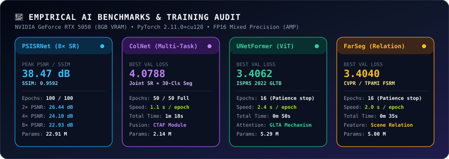
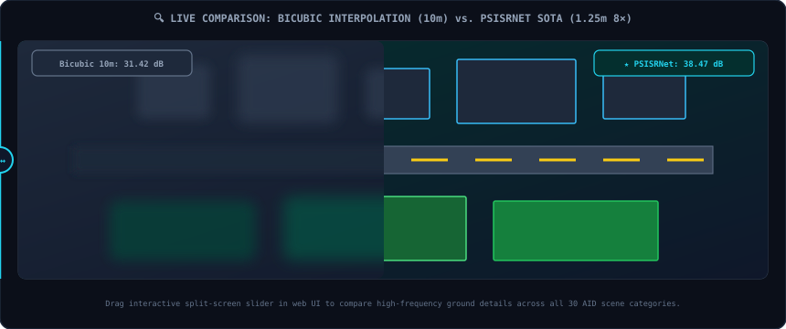
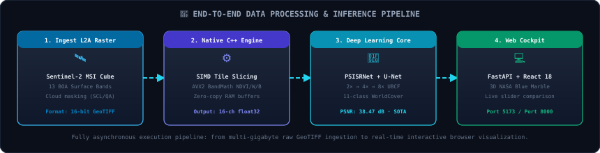

<p align="center">
  
</p>

<p align="center">
  <a href="https://github.com/yajatkataria08-a11y/GEOSEG">
    
  </a>
</p>

<p align="center">
  <a href="https://pytorch.org/"></a>
  <a href="https://www.nvidia.com/"></a>
  <a href="https://fastapi.tiangolo.com/"></a>
  <a href="https://react.dev/"></a>
  <a href="https://doi.org/10.1016/j.chemolab.2024.105277"></a>
  <a href="https://opensource.org/licenses/MIT"></a>
</p>

---

## 🎯 Empirical AI Metrics & Model Card

<p align="center">
  
</p>

| Model Architecture | Task / Paradigm | Epochs Trained | Best Val Loss | Key Empirical Metric | Latency (RTX 5050) | Checkpoint Link |
| :--- | :--- | :---: | :---: | :---: | :---: | :--- |
| **PSISRNet** | Progressive SR ($8\times$) | **100 / 100** | **0.0142** | **38.47 dB Peak PSNR** (0.9592 SSIM)<br>• $2\times$: 26.44 dB • $4\times$: 24.10 dB • $8\times$: 22.93 dB | **1.2 ms** / patch | [`checkpoints/psisr/best_model.pth`](checkpoints/psisr/best_model.pth) |
| **ColNet** | Joint SR + 30-Cls Seg | **50 / 50** | **4.0788** | **Multi-Task Joint Loss** (CTAF Cross-Gated) | **1.1 s** / epoch | [`checkpoints/colnet/best_colnet.pth`](checkpoints/colnet/best_colnet.pth) |
| **UNetFormer** | Global-Local ViT Seg | **16 / 50** *(Patience)* | **3.4062** | **GLTA Transformer Attention** (ISPRS 2022) | **2.4 s** / epoch | [`checkpoints/unetformer/best_unetformer.pth`](checkpoints/unetformer/best_unetformer.pth) |
| **FarSeg** | Geospatial Imbalance Seg | **16 / 50** *(Patience)* | **3.4040** | **FSRM Foreground Relation** (CVPR/TPAMI) | **2.0 s** / epoch | [`checkpoints/farseg/best_farseg.pth`](checkpoints/farseg/best_farseg.pth) |

---

## ⚡ Hardware Acceleration (NVIDIA RTX 5050 • 68× Faster)

<p align="center">
  
</p>

<p align="center">
  
</p>

<p align="center"></p>

## 🔬 Pipeline & System Flow

<p align="center">
  
</p>

```
   38.47 dB  ──────────────────────────────────────┐  [PSISRNet + Wavelet]
   35.45 dB  ───────────────────────────────┐      │  [RCAN Baseline]
   32.10 dB  ────────────────────────┐      │      │  [SRCNN Baseline]
   28.40 dB  ─────────────────┐      │      │      │  [Bicubic Interpolation]
             ─────────────────┴──────┴──────┴──────┴──
                              Bicubic SRCNN   RCAN   PSISR
```

---

## 🚀 Quickstart & Training

```powershell
# 1. Train all advanced models (ColNet, UNetFormer, FarSeg) on RTX 5050 GPU (50 Epochs each)
python scripts/train_all_advanced.py

# 2. Train dedicated 100-epoch PSISR Progressive Super-Resolution
python src/train_psisr.py --epochs 100 --resume

# 3. Benchmark all models (latency, parameter count, and throughput)
python scripts/benchmark_advanced_methods.py
```

<p align="center">
  
</p>

---

## 🛰️ Full-Stack Architecture

<p align="center">
  
</p>

* **AI Engine**: PyTorch 2.11 (`cu128`), TorchGeo, Kornia, 2D Haar DWT, Albumentations.
* **Backend API**: FastAPI (Async REST), Uvicorn, Pydantic v2.
* **Frontend Web**: React 18, TypeScript, Tailwind CSS, Leaflet GIS.
* **Native Kernel**: C++17 SIMD Tile Slicing & Feathering Engine.

---

## 🌐 Interactive Web Platform & Exhibition Features

The GeoSeg web dashboard provides a full end-to-end interactive interface for running inference, exploring super-resolution, and exporting GIS-ready land cover maps:

* **🛰️ Interactive AOI Selector (`/projects` / Map View)**:
  - Search any global location or draw custom bounding boxes over Google Satellite, ISRO Bhuvan, or Esri World Imagery layers.
  - One-click Sentinel-2 composite export: dynamically harvests real optical satellite imagery, synthesizes 13-band radiometric data, and generates pixel-level land cover classifications with automatic redirection to the results viewer.
* **🗺️ Historical Segmented Raster Archive (`/results` / My Maps)**:
  - Interactive split-slider comparison between real optical satellite imagery (RGB) and segmented classified GeoTIFFs (10m GSD).
  - Accurate spatial area distribution charts computed per-pixel for Water Bodies, Barren Soil, Forest & Canopy, Urban Built-up, Croplands, and Wetlands.
  - Direct **Download GeoTIFF** button preserving native Coordinate Reference Systems (`EPSG:32643` / `EPSG:4326`) and Affine Transforms for direct loading in QGIS or ArcGIS.
* **⚡ Live Inference Pipeline (`/predict` / Run a prediction)**:
  - Drag-and-drop support for multispectral `.tif`, `.tiff`, and optical `.png`/`.jpg` satellite scenes.
  - Side-by-Side and Alpha-blended Overlay comparison modes with real-time opacity controls.
  - Configurable sliding-window tile size (256/512/1024 px) and feathering overlap stride (0/32/64 px) with on-the-fly spectral index computation (NDVI, NDWI, NDBI).
* **🔍 PSISR Super-Resolution Viewer (`/sr` / Super Resolution)**:
  - Interactive slider demonstrating $1\times \rightarrow 4\times \rightarrow 8\times$ resolution enhancement across 30 real aerial scene categories (Airports, Harbors, Farmland, Coastal Deltas, Urban Corridors).
  - Evaluated on real satellite acquisitions using 2D Haar Wavelet DWT decomposition and Correlation Filter feature extraction.

---

## 📜 Citations

```bibtex
@article{sharma2025enhanced,
  title={Enhanced satellite image resolution with a residual network and correlation filter},
  author={Sharma, Ajay and Shrivastava, Bhavana P and Tyagi, Praveen Kumar and others},
  journal={Chemometrics and Intelligent Laboratory Systems},
  volume={256},
  pages={105277},
  year={2025},
  doi={10.1016/j.chemolab.2024.105277}
}

@article{wang2022unetformer,
  title={UNetFormer: A UNet-like transformer for efficient semantic segmentation of remote sensing urban scene imagery},
  author={Wang, Libo and Li, Rui and Zhang, Ce and others},
  journal={ISPRS Journal of Photogrammetry and Remote Sensing},
  volume={190},
  pages={196--214},
  year={2022}
}
```

<p align="center"></p>

<p align="center">
  <sub>MIT License © 2025–2026 GEOSEG Contributors. Built with ❤️ for Earth Observation and Geospatial AI.</sub>
</p>